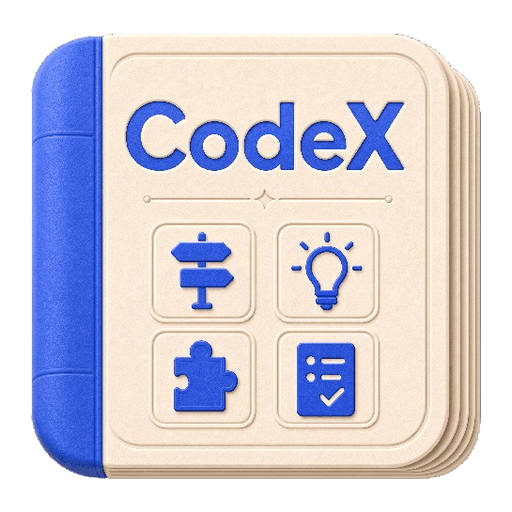
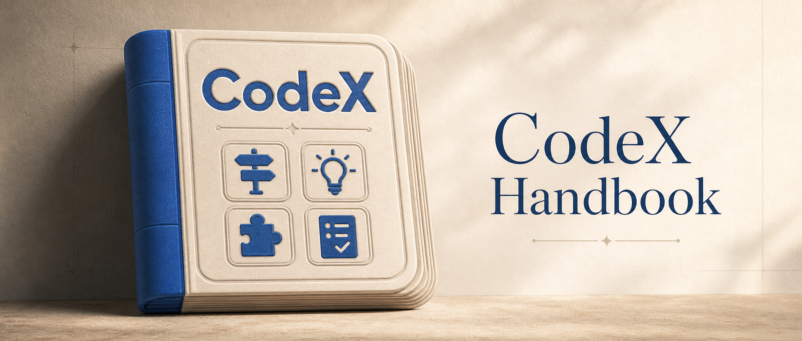

# Codex Handbook

<p align="center">
  
</p>

<p align="center">
  
</p>

<p align="center"><strong>Систематическое руководство и база практических знаний по Codex</strong></p>

<p align="center">
  <a href="./README.md">简体中文</a>
  ·
  <a href="./README.en.md">English</a>
  ·
  <a href="./README.zh-TW.md">繁體中文</a>
  ·
  <a href="./README.fr.md">Français</a>
  ·
  <a href="./README.ja.md">日本語</a>
  ·
  <a href="./README.ko.md">한국어</a>
  ·
  <a href="./README.es.md">Español</a>
  ·
  <a href="./README.de.md">Deutsch</a>
  ·
  <a href="./README.pt.md">Português</a>
  ·
  <a href="./README.vi.md">Tiếng Việt</a>
  ·
  <a href="./README.th.md">ไทย</a>
  ·
  <a href="./README.ru.md">Русский</a>
</p>

<p align="center">
  <a href="https://codexhandbook.com/ru/">Читать онлайн</a>
  ·
  <a href="./src/content/docs/ru/guide/index.md">Руководство для начинающих</a>
  ·
  <a href="./docs/planning/content-architecture.md">Архитектура контента</a>
  ·
  <a href="./STYLE_GUIDE.md">Редакционные стандарты</a>
  ·
  <a href="./examples/README.md">Библиотека примеров</a>
</p>

<p align="center">
  <a href="https://codexhandbook.com/"></a>
  <a href="https://codexhandbook.com/ru/"></a>
  <a href="https://starlight.astro.build/"></a>
</p>

> От первого запуска Codex до полноценного применения в проектах, рабочих процессах и долгосрочном накоплении знаний.  
> Это не разрозненный сборник советов, а систематическое практическое руководство, организованное по разделам `Руководство / Промпты / Skills / Практические примеры`.

## Что это такое

**Codex Handbook** — систематическая база знаний для изучения и практического применения Codex. Она отвечает не на слишком общий вопрос «что умеет Codex?», а на три более прикладных вопроса:

- С чего начать знакомство с Codex.
- Как описывать задачи, организовывать контекст и проверять результат при работе с Codex в реальных проектах.
- Как после успешной совместной работы превращать накопленный опыт в промпты, Skills, правила, примеры и командные ресурсы.

Если вы только начинаете знакомство с Codex, этот репозиторий и сайт станут хорошей отправной точкой.

## С чего начать

### 1. Читать онлайн

Основная точка входа — [codexhandbook.com/ru](https://codexhandbook.com/ru/).  
На сайте доступны полная навигация, поиск, структура по главам и регулярно обновляемые материалы, поэтому начинать чтение удобнее там.

### 2. Первый маршрут для начинающих

Рекомендуем читать разделы в таком порядке:

1. [Руководство](./src/content/docs/ru/guide/index.md)
2. [Контекст и файлы](./src/content/docs/ru/guide/context/index.md)
3. [Промпты](./src/content/docs/ru/prompts/index.md)
4. [Skills](./src/content/docs/ru/skills/index.md)
5. [Практические примеры](./src/content/docs/ru/cases/index.mdx)

Этот маршрут рассчитан на тех, кто впервые работает с Codex: сначала он помогает сформировать прочную базу, а затем перейти к практике.

## Чему вы здесь научитесь

### Руководство

Вы разберётесь, как выбрать подходящий способ работы с Codex, освоить основные сценарии, организовать контекст, учитывать границы разрешений и проверять результаты.

### Промпты

Вы научитесь ясно формулировать задачу, задавать ограничения, цели, входные материалы и критерии приёмки, чтобы Codex стабильно выдавал результат, который можно проверить.

### Skills

Вы узнаете, как проектировать, применять, поддерживать и контролировать Skills, превращая однажды найденный успешный подход в повторно используемый рабочий процесс.

### Практические примеры

На реальных задачах вы изучите полный рабочий цикл: чтение кода, исправление ошибок, подготовку документации, исследования, автоматизацию и совместную работу над передачей результата.

## Для кого это руководство

- Для тех, кто впервые знакомится с Codex.
- Для разработчиков, которые хотят применять Codex в реальных проектах.
- Для команд, которым важно накапливать промпты, правила, шаблоны и практические примеры.
- Для специалистов, работающих с информацией и использующих Codex для написания текстов, исследований, документации и презентаций.

## Быстрые ссылки

| Раздел | Назначение |
| --- | --- |
| [Читать онлайн](https://codexhandbook.com/ru/) | Просмотреть полное руководство на сайте |
| [Руководство](./src/content/docs/ru/guide/index.md) | Разобраться с Codex с самого начала |
| [Промпты](./src/content/docs/ru/prompts/index.md) | Научиться ясно описывать задачи и их границы |
| [Skills](./src/content/docs/ru/skills/index.md) | Превращать опыт в повторно используемые рабочие процессы |
| [Практические примеры](./src/content/docs/ru/cases/index.mdx) | Изучить сквозные рабочие процессы на реальных задачах |
| [Примеры](./examples/README.md) | Использовать готовые промпты и другие материалы |
| [Архитектура контента](./docs/planning/content-architecture.md) | Быстро понять информационную структуру сайта |
| [План глав](./docs/planning/chapter-outline.md) | Посмотреть охват тем |
| [Редакционные и визуальные стандарты](./STYLE_GUIDE.md) | Соблюдать единый стиль текста, примеров, проверки фактов и схем |
| [Как внести вклад](./CONTRIBUTING.md) | Узнать, как предлагать учебные материалы, примеры, схемы и переводы |

## Структура контента

```text
Codex Handbook
├── src/content/docs/ru/guide/   # Начало работы, клиенты, разрешения, проверка
├── src/content/docs/ru/prompts/ # Методика промптов и постановка задач
├── src/content/docs/ru/skills/  # Проектирование, применение и контроль Skills
├── src/content/docs/ru/cases/   # Примеры реальных задач
├── examples/                    # Готовые промпты и расширенные примеры
├── docs/planning/               # Планирование и сопровождение контента
```

## Локальная разработка

Сайт документации построен на [Astro](https://astro.build/) и [Starlight](https://starlight.astro.build/). Основные материалы находятся в каталоге `src/content/docs/`.

Требования к окружению:

- Node.js `>=22.12.0`
- `pnpm`

Запуск среды разработки:

```bash
pnpm install
pnpm dev
```

Сборка статического сайта:

```bash
pnpm build
```

## Принципы проекта

- **Официальные источники прежде всего:** сведения о возможностях продукта, правилах и ограничениях в первую очередь сверяются с официальными материалами.
- **Доступность для начинающих:** знание терминала, Git, Agent или автоматизации не предполагается.
- **Ориентация на реальные задачи:** главное — многократно используемые рабочие процессы, примеры и шаблоны, а не нагромождение абстрактных понятий.
- **Ясные границы безопасности:** риски, связанные с разрешениями, записью файлов, доступом к сети, автоматизацией и расширениями, должны быть объяснены явно.
- **Накопление опыта:** успешное решение задачи стоит превращать в промпты, Skills, правила, примеры и командные ресурсы.

## Как внести вклад

Мы приветствуем:

- переработанные учебные материалы, понятные начинающим;
- воспроизводимые примеры реальных задач;
- качественные промпты, шаблоны Skill, примеры конфигурации и материалы для практических сценариев;
- проверку фактов и исправление устаревшего контента;
- материалы на английском, традиционном китайском и других языках.

Если вы хотите помочь с контентом, начните с этих документов:

- [Как внести вклад](./CONTRIBUTING.md)
- [Редакционные и визуальные стандарты](./STYLE_GUIDE.md)
- [Описание библиотеки примеров](./examples/README.md)
- [Архитектура контента](./docs/planning/content-architecture.md)
- [План глав](./docs/planning/chapter-outline.md)

## Отказ от ответственности

Этот проект — поддерживаемое сообществом практическое руководство по Codex, а не официальный проект OpenAI. Актуальные сведения о функциях, ценах, доступности, правилах безопасности и других особенностях продукта следует проверять по официальным источникам.
