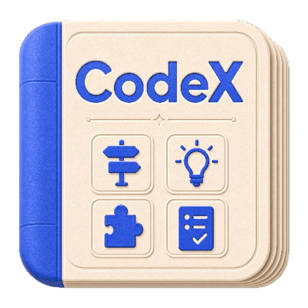
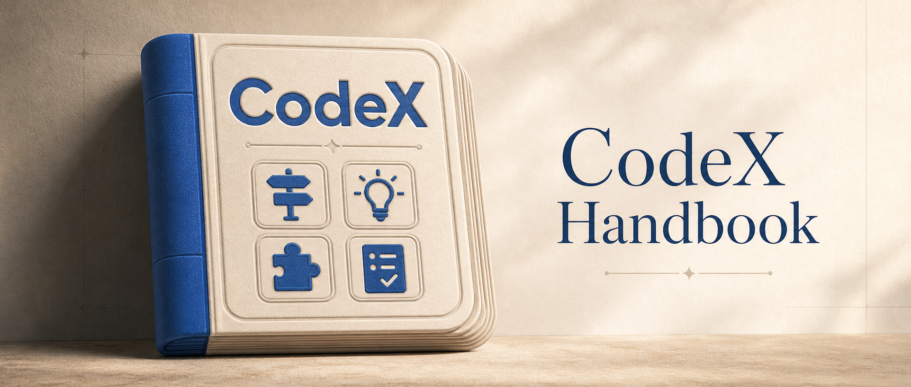

# Codex Handbook

<p align="center">
  
</p>

<p align="center">
  
</p>

<p align="center"><strong>คู่มือ Codex อย่างเป็นระบบและฐานความรู้ภาคปฏิบัติ</strong></p>

<p align="center">
  <a href="./README.md">简体中文</a>
  ·
  <a href="./README.en.md">English</a>
  ·
  <a href="./README.zh-TW.md">繁體中文</a>
  ·
  <a href="./README.fr.md">Français</a>
  ·
  <a href="./README.ja.md">日本語</a>
  ·
  <a href="./README.ko.md">한국어</a>
  ·
  <a href="./README.es.md">Español</a>
  ·
  <a href="./README.de.md">Deutsch</a>
  ·
  <a href="./README.pt.md">Português</a>
  ·
  <a href="./README.vi.md">Tiếng Việt</a>
  ·
  <a href="./README.th.md">ไทย</a>
  ·
  <a href="./README.ru.md">Русский</a>
</p>

<p align="center">
  <a href="https://codexhandbook.com/th/">อ่านออนไลน์</a>
  ·
  <a href="./src/content/docs/th/guide/index.md">คู่มือสำหรับผู้เริ่มต้น</a>
  ·
  <a href="./docs/planning/content-architecture.md">สถาปัตยกรรมเนื้อหา</a>
  ·
  <a href="./STYLE_GUIDE.md">แนวทางการเขียน</a>
  ·
  <a href="./examples/README.md">คลังตัวอย่าง</a>
</p>

<p align="center">
  <a href="https://codexhandbook.com/"></a>
  <a href="https://codexhandbook.com/th/"></a>
  <a href="https://starlight.astro.build/"></a>
</p>

> ตั้งแต่เปิด Codex เป็นครั้งแรก ไปจนถึงนำไปใช้จริงในโปรเจกต์ เวิร์กโฟลว์ และการสะสมองค์ความรู้ระยะยาว  
> นี่ไม่ใช่ชุดเคล็ดลับกระจัดกระจาย แต่เป็นคู่มือภาคปฏิบัติอย่างเป็นระบบที่จัดหมวดหมู่เป็น `คู่มือ / พรอมต์ / Skills / กรณีศึกษาภาคปฏิบัติ`

## นี่คืออะไร

**Codex Handbook** คือฐานความรู้อย่างเป็นระบบสำหรับการเรียนรู้และใช้งาน Codex โดยไม่ได้มุ่งตอบคำถามกว้าง ๆ ว่า “Codex ทำอะไรได้บ้าง” แต่เน้นตอบคำถามที่นำไปใช้จริงได้มากกว่าสามข้อ:

- เมื่อเริ่มใช้ Codex เป็นครั้งแรก ควรเริ่มจากตรงไหน
- เมื่อต้องการใช้ Codex ในโปรเจกต์จริง ควรอธิบายงาน จัดบริบท และตรวจสอบผลลัพธ์อย่างไร
- หลังจากทำงานร่วมกันสำเร็จหนึ่งครั้ง จะตกผลึกประสบการณ์ให้เป็นพรอมต์ Skills กฎ กรณีศึกษา และสินทรัพย์ของทีมได้อย่างไร

หากคุณเพิ่งเริ่มทำความรู้จัก Codex รีโพซิทอรีและเว็บไซต์นี้คือจุดเริ่มต้นของคุณ

## เริ่มต้นจากที่นี่

### 1. อ่านออนไลน์

ช่องทางหลักสำหรับอ่านคือ [codexhandbook.com/th](https://codexhandbook.com/th/)  
หากต้องการเมนูนำทาง การค้นหา โครงสร้างบท และเนื้อหาที่อัปเดตต่อเนื่องอย่างครบถ้วน แนะนำให้อ่านจากเว็บไซต์

### 2. เส้นทางอ่านแรกสำหรับผู้เริ่มต้น

แนะนำให้อ่านตามลำดับนี้:

1. [หน้าแรกของ Guide](./src/content/docs/th/guide/index.md)
2. [บริบทและไฟล์](./src/content/docs/th/guide/context/index.md)
3. [Prompts](./src/content/docs/th/prompts/index.md)
4. [Skills](./src/content/docs/th/skills/index.md)
5. [Cases](./src/content/docs/th/cases/index.mdx)

เส้นทางนี้เหมาะกับผู้ที่เพิ่งเริ่มใช้ Codex ช่วยให้สร้างพื้นฐานความเข้าใจที่มั่นคงก่อนเข้าสู่ภาคปฏิบัติ

## คุณจะได้เรียนรู้อะไรที่นี่

### คู่มือ

ทำความเข้าใจวิธีเลือกช่องทางเข้าใช้งาน Codex เส้นทางใช้งานพื้นฐาน การจัดบริบท ขอบเขตสิทธิ์ และวิธีตรวจสอบผลลัพธ์

### พรอมต์

เรียนรู้วิธีอธิบายงานให้ชัดเจน กำหนดข้อจำกัด เป้าหมาย อินพุต และเกณฑ์การยอมรับ เพื่อให้ Codex สร้างผลลัพธ์ที่ตรวจสอบได้อย่างสม่ำเสมอ

### Skills

เรียนรู้วิธีออกแบบ ใช้งาน ดูแล และกำกับ Skills เพื่อเปลี่ยนความร่วมมือที่สำเร็จหนึ่งครั้งให้เป็นความสามารถที่นำกลับมาใช้ซ้ำได้ในระยะยาว

### กรณีศึกษาภาคปฏิบัติ

ทำความเข้าใจเวิร์กโฟลว์ครบวงจรผ่านงานจริง เช่น อ่านโค้ด แก้บั๊ก เขียนเอกสาร ทำวิจัย ทำงานอัตโนมัติ และร่วมกันส่งมอบงาน

## เหมาะกับใคร

- ผู้เริ่มต้นที่เพิ่งทำความรู้จัก Codex
- นักพัฒนาที่ต้องการใช้ Codex ในโปรเจกต์จริง
- ทีมที่ต้องการสะสมพรอมต์ กฎ เทมเพลต และกรณีศึกษา
- คนทำงานด้านความรู้ที่ต้องการใช้ Codex สำหรับงานเขียน งานวิจัย เอกสาร และงานนำเสนอ

## ทางเข้าด่วน

| ทางเข้าด่วน | ใช้ทำอะไร |
| --- | --- |
| [อ่านออนไลน์](https://codexhandbook.com/th/) | เปิดดูคู่มือทั้งชุดบนเว็บไซต์ |
| [Guide](./src/content/docs/th/guide/index.md) | ทำความเข้าใจเส้นทางใช้งาน Codex ตั้งแต่เริ่มต้น |
| [Prompts](./src/content/docs/th/prompts/index.md) | เรียนรู้วิธีอธิบายงานและขอบเขตให้ชัดเจน |
| [Skills](./src/content/docs/th/skills/index.md) | เรียนรู้วิธีตกผลึกประสบการณ์เป็นความสามารถที่ใช้ซ้ำได้ |
| [Cases](./src/content/docs/th/cases/index.mdx) | ทำความเข้าใจเวิร์กโฟลว์ต้นจนจบผ่านงานจริง |
| [Examples](./examples/README.md) | นำพรอมต์และสินทรัพย์ตัวอย่างไปใช้ซ้ำได้ทันที |
| [สถาปัตยกรรมเนื้อหา](./docs/planning/content-architecture.md) | ทำความเข้าใจการออกแบบข้อมูลของทั้งเว็บไซต์อย่างรวดเร็ว |
| [โครงร่างบท](./docs/planning/chapter-outline.md) | ดูขอบเขตหัวข้อที่ครอบคลุม |
| [แนวทางการเขียนและงานภาพ](./STYLE_GUIDE.md) | ใช้มาตรฐานเดียวกันสำหรับสำนวน ตัวอย่าง การตรวจสอบข้อเท็จจริง และแผนภาพ |
| [ร่วมพัฒนา](./CONTRIBUTING.md) | ดูเวิร์กโฟลว์สำหรับส่งบทเรียน กรณีศึกษา แผนภาพ และคำแปล |

## โครงสร้างเนื้อหา

```text
Codex Handbook
├── src/content/docs/th/guide/   # คู่มือเริ่มต้น ไคลเอนต์ สิทธิ์ และการตรวจสอบ
├── src/content/docs/th/prompts/ # วิธีเขียนพรอมต์และอธิบายงาน
├── src/content/docs/th/skills/  # การออกแบบ ใช้งาน และกำกับ Skills
├── src/content/docs/th/cases/   # กรณีศึกษาจากงานจริง
├── examples/                    # พรอมต์ที่คัดลอกใช้ได้และตัวอย่างส่วนขยาย
├── docs/planning/               # เอกสารวางแผนและดูแลเนื้อหา
```

## พัฒนาในเครื่อง

โปรเจกต์นี้ใช้ [Astro](https://astro.build/) + [Starlight](https://starlight.astro.build/) สร้างเว็บไซต์เอกสาร เนื้อหาภาษาไทยอยู่ใน `src/content/docs/th/`

ข้อกำหนดของสภาพแวดล้อม:

- Node.js `>=22.12.0`
- `pnpm`

เริ่มสภาพแวดล้อมสำหรับพัฒนา:

```bash
pnpm install
pnpm dev
```

สร้างเว็บไซต์แบบสแตติก:

```bash
pnpm build
```

## หลักการของโปรเจกต์

- ให้ความสำคัญกับแหล่งข้อมูลทางการ: เมื่อกล่าวถึงความสามารถ กฎ และขอบเขตของผลิตภัณฑ์ ให้ยึดเอกสารทางการเป็นหลัก
- เป็นมิตรกับผู้เริ่มต้น: ไม่สมมติว่าผู้อ่านมีพื้นฐานด้านเทอร์มินัล, Git, Agent หรือระบบอัตโนมัติ
- มุ่งเน้นงานจริง: เน้นเวิร์กโฟลว์ กรณีศึกษา และเทมเพลตที่นำกลับมาใช้ซ้ำได้ แทนการเรียงซ้อนแนวคิดนามธรรม
- ขอบเขตความปลอดภัยชัดเจน: ต้องอธิบายความเสี่ยงของสิทธิ์ การเขียนไฟล์ การเชื่อมต่อเครือข่าย ระบบอัตโนมัติ และส่วนขยายให้ครบถ้วน
- ต่อยอดอย่างต่อเนื่อง: สนับสนุนให้เปลี่ยนงานที่สำเร็จหนึ่งครั้งเป็นพรอมต์ Skills กฎ กรณีศึกษา และสินทรัพย์ของทีม

## ร่วมพัฒนา

เรายินดีรับ:

- การปรับบทเรียนให้อ่านง่ายสำหรับผู้เริ่มต้น
- กรณีศึกษาจริงที่ทำซ้ำได้
- พรอมต์คุณภาพสูง เทมเพลต Skill ตัวอย่างการกำหนดค่า และสื่อประกอบกรณีศึกษา
- การตรวจสอบข้อเท็จจริงและแก้ไขเนื้อหาที่ล้าสมัย
- เนื้อหาภาษาอื่น เช่น English และ繁體中文

หากต้องการร่วมสร้างเนื้อหา แนะนำให้เริ่มจาก:

- [ร่วมพัฒนา](./CONTRIBUTING.md)
- [แนวทางการเขียนและงานภาพ](./STYLE_GUIDE.md)
- [คำอธิบายคลังตัวอย่าง](./examples/README.md)
- [สถาปัตยกรรมเนื้อหา](./docs/planning/content-architecture.md)
- [โครงร่างบท](./docs/planning/chapter-outline.md)

## ข้อสงวนสิทธิ์

โปรเจกต์นี้เป็นคู่มือภาคปฏิบัติ Codex ที่ดูแลโดยชุมชน ไม่ใช่โปรเจกต์ทางการของ OpenAI สำหรับข้อมูลที่เปลี่ยนแปลงตามเวลา เช่น ฟีเจอร์ ราคา ความพร้อมใช้งาน นโยบายความปลอดภัย และรายละเอียดผลิตภัณฑ์ โปรดตรวจสอบจากแหล่งข้อมูลทางการ
